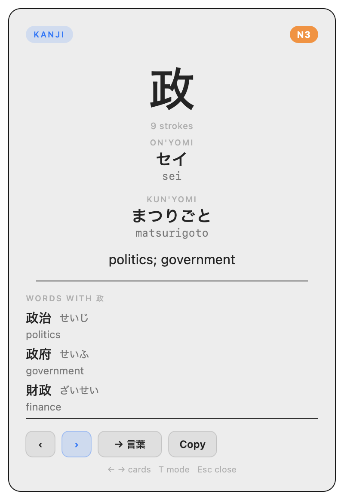
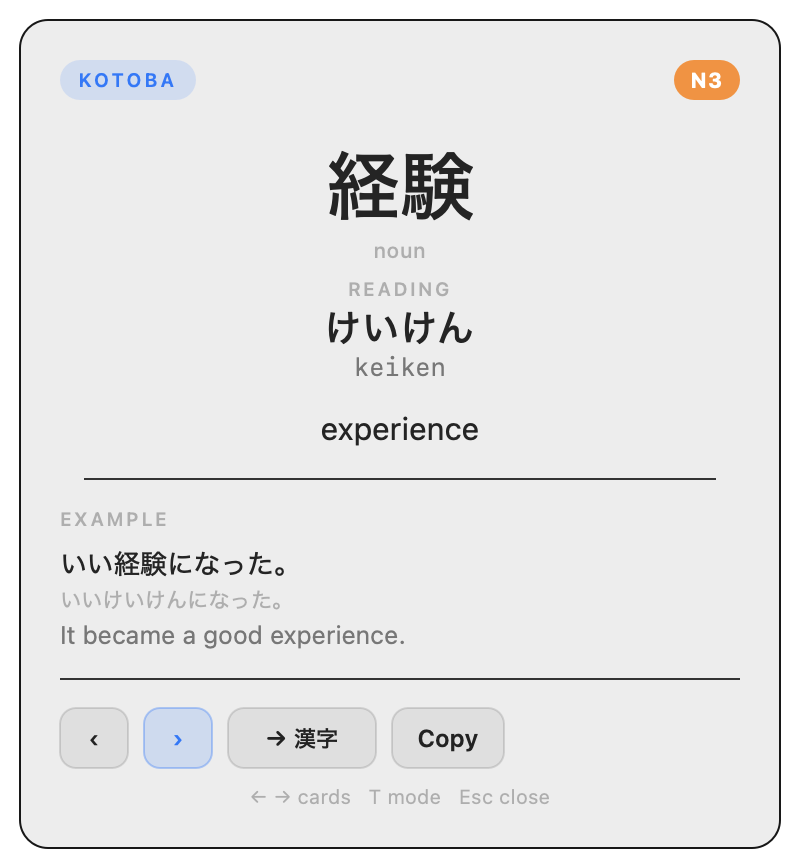
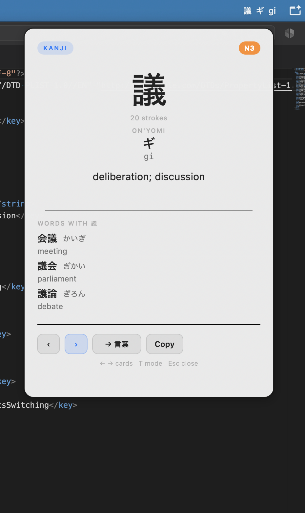

# KanjiBar

A small macOS **menu bar widget** that shows a JLPT **N3** kanji or vocabulary
word together with its **furigana**, **romaji** and English meaning — one click,
no app window, no Dock icon. The widget rotates between the 漢字 and 言葉 decks
every 15 seconds and pauses while you are reading a card.

Built with **Go** (state, data, romaji, timer) and **AppKit/Objective-C** (the
native status item and popover-style card). It compiles with the Command Line
Tools — Xcode is not required.

| Menu bar (`政 セイ sei`) | Kanji card | Kotoba card |
| --- | --- | --- |
|  |  |  |



## Install

```bash
./build.sh --install      # builds, ad-hoc signs, copies to ~/Applications, launches
```

Or build only and run it from anywhere:

```bash
./build.sh
open dist/KanjiBar.app
```

The app is a 2 MB bundle, ad-hoc signed, `LSUIElement` (no Dock icon), and keeps
its state in `~/Library/Application Support/KanjiBar/state.json`.

## Use

- The menu bar title shows the kanji/word, its **furigana** and its **romaji**
  (`政 セイ sei`, `経験 けいけん keiken`). Every 15 s it flips between the two
  decks — but **not while the card is open**, so reading is never interrupted.
- **Left-click the menu bar item** — opens the card.
- **Right-click** — context menu (next / previous / toggle deck / auto-switch /
  menu bar furigana & romaji / copy / quit).
- **← →** or **space** — previous / next card while the card is open.
- **T** — switch between the kanji deck (漢字) and the vocabulary deck (言葉).
- **A** — toggle the 15 s deck auto-switch (paused while the card is open).
- **F** — toggle furigana in the menu bar title (`政 セイ  sei` ⇄ `政  sei`).
- **R** — toggle romaji in the menu bar title (`政 セイ  sei` ⇄ `政  セイ`).
- **C** — copy the current card as text.
- **Esc** — close the card.

Clicking anywhere outside the card dismisses it and returns focus to the app you
were using. The current card, deck and preferences survive restarts.

Every card is rendered at **one fixed content size**, and the menu bar item
anchors the popover's arrow, so flipping decks or advancing cards never moves
or resizes the widget. The footer (‹ › / deck / copy) is bottom-anchored, so the
nav buttons stay put no matter how much text a card has. Spare space on shorter
cards is spread into the card body, not into the footer.

The card is a native `NSPopover`, so it grows out of the menu bar item with the
system animation, points back at the item with the system arrow, dismisses on an
outside click, and fades out quickly when closed with `Esc`/the status item.

While the card is open the menu bar title is **frozen** (the newest one is
applied when it closes). Re-laying-out the status item under a live popover
would make the card shift or dismiss, so this is what keeps the popover pinned
in place no matter how many cards you page through.

One click always equals one action: the status item remembers whether the card
was open at mouse-down, and a click that lands while the popover is closing is
remembered and honored as soon as it finishes — so open → close → open never
needs a second click.

## The decks

| Deck | File | Entries | Contents |
| --- | --- | --- | --- |
| 漢字 Kanji | `data/kanji.json` | 200 N3 kanji | on'yomi (katakana), kun'yomi (hiragana), English gloss, 3 common compounds with kana + meaning |
| 言葉 Kotoba | `data/kotoba.json` | 210 N3 words | kana reading, part of speech, English gloss, example sentence with kana transcript + translation |

Both decks are **N3 only** (`"level": 3`); the mode pill and the orange `N3`
badge reflect that. To study another level, replace the JSON files — the schema
is validated at startup and by `go test`:

```jsonc
// data/kanji.json (array of entries)
{
  "char": "連", "level": 3, "strokes": 10,
  "on": ["レン"], "kun": ["つら"],
  "meaning": "connect; take along",
  "compounds": [
    {"word": "連絡", "kana": "れんらく", "meaning": "contact"},
    {"word": "連続", "kana": "れんぞく", "meaning": "continuation"},
    {"word": "関連", "kana": "かんれん", "meaning": "relation"}
  ]
}

// data/kotoba.json (array of entries)
{
  "word": "経験", "kana": "けいけん", "level": 3, "pos": "noun",
  "meaning": "experience",
  "example": {
    "jp": "いい経験になった。",
    "kana": "いいけいけんになった。",
    "en": "It became a good experience."
  }
}
```

### Where furigana and romaji come from

Furigana in the menu bar is the first reading from the deck (on'yomi in
katakana for kanji, the kana spelling for words); romaji is generated from that
reading.


Romaji is **generated at runtime** from the kana rather than stored, so the
dataset stays small and the transliteration stays consistent. `romaji.go`
implements Hepburn-ish rules: yōon (`しゃ` → sha), small tsu gemination
(`まっちゃ` → matcha), katakana long vowels (`コーヒー` → koohii), `ん`
disambiguation, and a small override table for words where `は` is the particle
(`こんにちは` → konnichiwa). `romaji_test.go` covers the tricky cases.

## Architecture

```
main.go        flags, bootstrap: load deck → start AppKit → run loop
app.go         study state: mode, per-deck position, auto-advance, persistence
card.go        builds the Card view model (one JSON object per screen)
data.go        embedded JSON decks + validation
romaji.go      kana → romaji
bridge.go      cgo bridge; Go exports GoNext/GoPrev/GoToggle* for ObjC
appkit.h/.m    AppKit: NSStatusItem, borderless status-level panel, custom drawing
instance.go    single-instance flock
build.sh       go vet + go test + go build + Info.plist + ad-hoc sign
```

Data flows one way for rendering and the other way for input:

- Go owns the state and pushes a `Card` to ObjC as JSON (`KBShowCard`). The
  Objective-C card view measures and draws every string itself — no XIBs, no
  Auto Layout, full control over the look.
- Button clicks and key presses call back into Go (`GoNext`, `GoToggleMode`, …),
  which updates state and pushes a fresh card. That keeps the UI a dumb renderer
  and the study logic testable (`go test` runs it headlessly).

### Why Go, and the one AppKit gotcha

Go gives a tiny, dependency-free binary that starts instantly; AppKit gives a
real `NSStatusItem` instead of a floating window. The whole UI sits behind a
~100-line cgo surface.

The cgo/Objective-C code is compiled **without ARC**, so long-lived AppKit
objects must be retained manually. The status item in particular is
autoreleased — it has to be `retain`ed or later title updates crash. That is
also why the status item is retained explicitly; without that, every later
title update and even showing an `NSPopover` from it crashed. The card itself is
a native `NSPopover` (`NSPopoverBehaviorTransient`), which supplies the arrow,
the system show animation and outside-click dismissal; the content view only
draws the card text on an opaque face.

## Development

```bash
go test ./...                     # deck validation, romaji, state transitions
./build.sh                        # vet + test + bundle
```

Useful dev flags (run the binary directly, not through `open`):

```bash
dist/KanjiBar.app/Contents/MacOS/KanjiBar --show --exit-after 8   # open card, quit after 8s
dist/KanjiBar.app/Contents/MacOS/KanjiBar --cycle 2               # advance every 2s
dist/KanjiBar.app/Contents/MacOS/KanjiBar --snapshot out.png --mode kotoba --index 7 [--dark]
dist/KanjiBar.app/Contents/MacOS/KanjiBar --logfile /tmp/kb.log
```

`--snapshot` renders one card to PNG headlessly, which is handy for design
iterations and for regenerating the images in `docs/`.

`KB_DEBUG_FRAME=1` in the environment prints panel geometry and menu bar title
changes to stderr — useful when tuning layout.

## Notes / limitations

- Ad-hoc signed, not notarized. Locally built apps run fine; distributing it to
  another Mac would need a Developer ID signature and notarization.
- No "launch at login" yet (add `SMAppService` if you want it).
- The menu bar title is kanji + furigana + romaji, so very long words widen the
  item; turn off furigana (`F`) or romaji (`R`) for a tighter fit.
- macOS 26 hosts status items through Control Center scenes; the app deliberately
  keeps every status item mutation on the main thread and retains the item.
